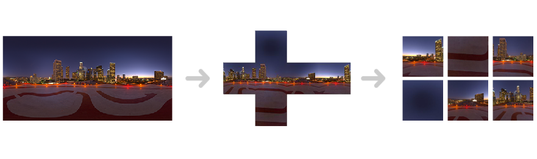

<p align="center">
  
</p>

<h1 align="center">sphere2cubeGo</h1>

<p align="center">
  Fast, zero-dependency CLI tool to convert equirectangular panoramas into cubemap faces.
</p>

<p align="center">
  <a href="https://github.com/flash286/sphere2cubeGo/actions/workflows/ci.yml"></a>
  <a href="https://goreportcard.com/report/github.com/flash286/sphere2cubeGo"></a>
  
  <a href="LICENSE"></a>
</p>

---

## What it does

Takes a single equirectangular (2:1 ratio) panoramic image and produces six cubemap face images — ready for OpenGL, game engines, or any 3D renderer that uses cube-mapped textures.

**Input:** one panorama (JPEG or PNG) &rarr; **Output:** `up.jpg`, `down.jpg`, `front.jpg`, `back.jpg`, `left.jpg`, `right.jpg`

## Features

- **Zero external dependencies** — only Go standard library
- **Parallel rendering** — all 6 faces rendered concurrently via goroutines
- **Pre-computed trig cache** — angle lookup tables eliminate redundant `math.Acos`/`math.Atan` calls
- **Direct pixel manipulation** — writes to raw `Pix` byte slices, no per-pixel allocations
- **Cross-platform** — builds for Linux, macOS, and Windows (amd64, arm64)

## Performance

Benchmarked on Intel Xeon Platinum 8581C:

| Panorama | Tile size | 6 faces rendered in |
|----------|-----------|---------------------|
| 2048x1024 | 256px | ~27ms |
| 4096x2048 | 512px | ~100ms |
| 4096x2048 | 1024px | ~337ms |

## Installation

```bash
go install github.com/flash286/sphere2cubeGo@latest
```

Or build from source:

```bash
git clone https://github.com/flash286/sphere2cubeGo.git
cd sphere2cubeGo
go build -o sphere2cubeGo .
```

## Usage

Basic — converts panorama to 1024px cubemap faces in `./build/`:

```bash
./sphere2cubeGo -i panorama.jpg
```

Custom tile size:

```bash
./sphere2cubeGo -i panorama.jpg -s 2048
```

Custom output directory and JPEG quality:

```bash
./sphere2cubeGo -i panorama.jpg -s 2048 -o /path/to/output -q 95
```

### All flags

| Flag | Default | Description |
|------|---------|-------------|
| `-i` | *(required)* | Path to input equirectangular panorama (JPEG or PNG) |
| `-s` | `1024` | Size in pixels of each output face |
| `-o` | `./build` | Output directory |
| `-q` | `100` | JPEG output quality (1–100) |

## How it works

1. **Decode** the equirectangular panorama into a flat pixel buffer
2. **Pre-compute** trigonometric lookup tables (acos, atan) for the given tile size
3. **Map** each pixel of each cube face back to spherical coordinates (theta, phi), then to the source panorama pixel
4. **Write** the six output JPEG files

The math maps 3D cube-face coordinates → spherical (theta, phi) → 2D equirectangular (x, y):

```
cube pixel (tx, ty) → normalize to [-1, 1]
                     → compute theta = acos(z/r), phi = atan(y/x)
                     → x_pano = width * (phi/pi + 1) / 2
                     → y_pano = height * theta / pi
```

## Project structure

```
.
├── main.go              # CLI entry point, flag parsing, orchestration
├── worker/
│   └── worker.go        # Core rendering: panorama decoding, pixel mapping, tile generation
├── cache/
│   └── cache.go         # Pre-computed trigonometric lookup tables
├── saver/
│   └── saver.go         # JPEG output writer
├── main_test.go         # E2E and benchmark tests
├── *_test.go            # Unit tests in each package
└── .github/workflows/
    └── ci.yml           # CI: test, vet, cross-platform build
```

## Running tests

```bash
# Unit + E2E tests
go test ./...

# Benchmarks
go test -bench=. -benchmem -run=^$

# Skip slow tests
go test ./... -short
```

## License

[Apache License 2.0](LICENSE)
